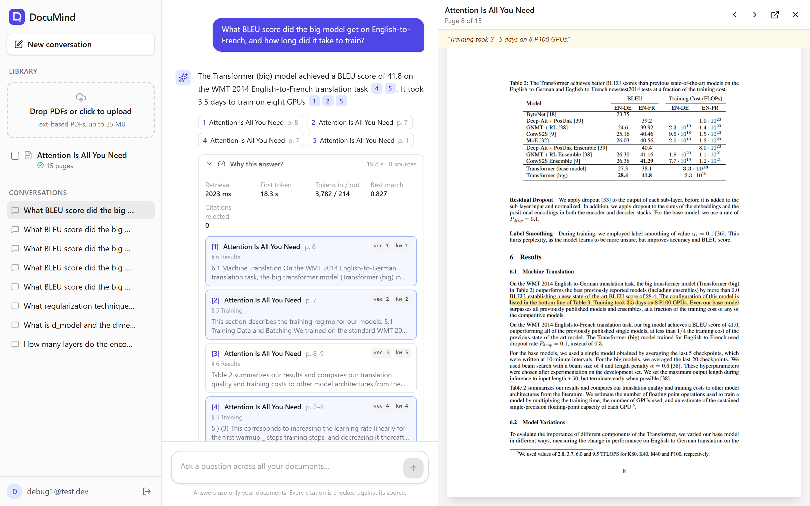
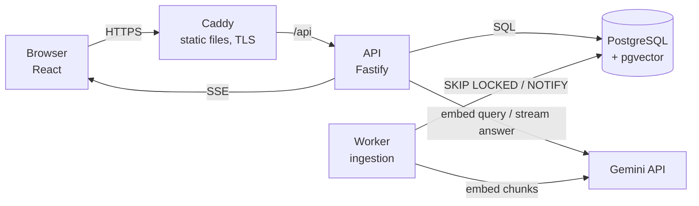
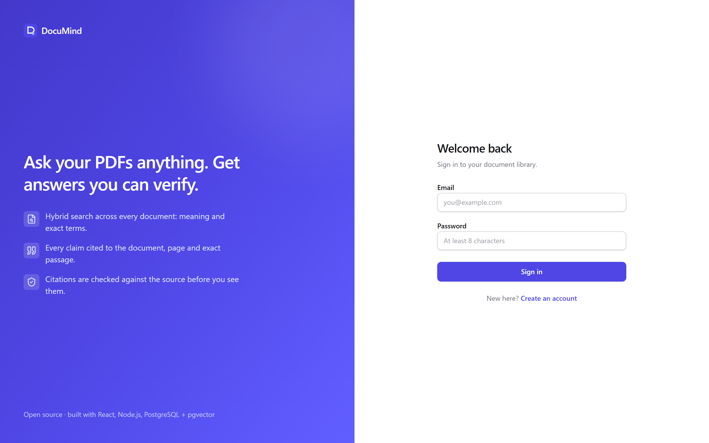
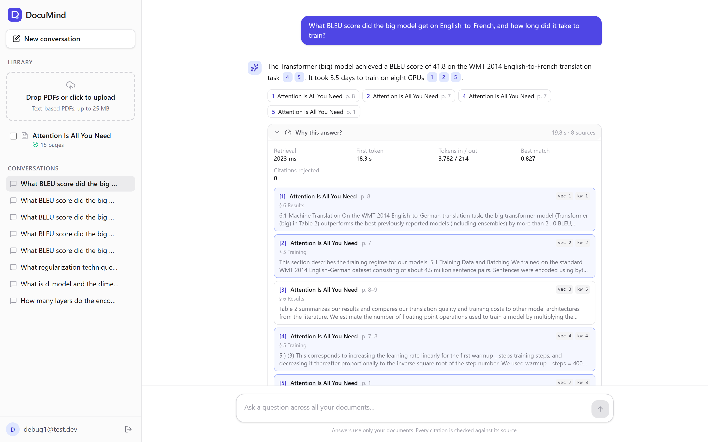
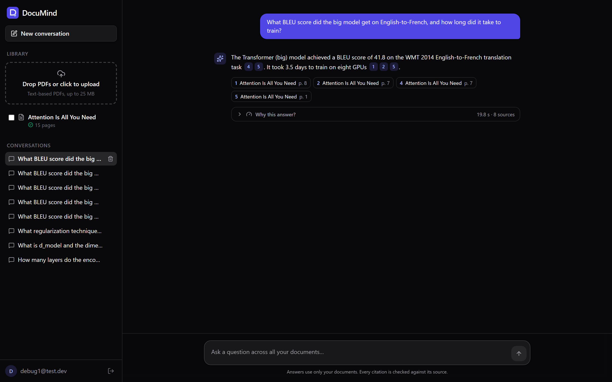
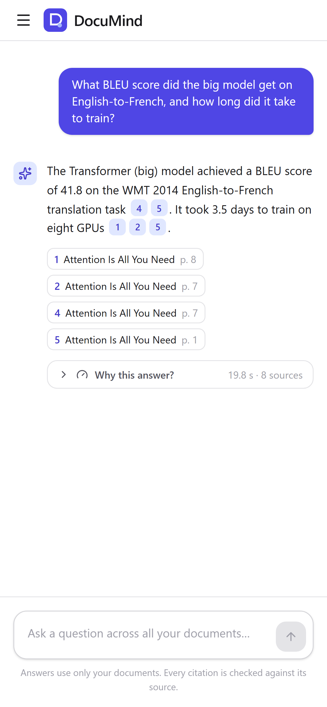

# DocuMind

[](https://github.com/manak-gupta/documind/actions/workflows/ci.yml)

**Ask questions across your PDFs. Every claim is cited to the document, page and exact passage, and
checked against the source before you see it.** Click a citation and the PDF opens at that page
with the passage highlighted.



**Stack:** React 19 · TypeScript · Node.js 26 (Fastify) · PostgreSQL 17 + pgvector · Gemini API
(behind a provider-agnostic layer) · Docker · Caddy · GitHub Actions

---

## Highlights

- **Hybrid retrieval in one SQL query.** pgvector (HNSW) and Postgres full-text search, fused with
  weighted Reciprocal Rank Fusion. Access control and document filters live in the same query.
- **Citations verified on the server.** The model must quote its source; any quote that isn't
  really in the cited passage is removed before the answer is shown.
- **"Why this answer?"** Every answer stores its trace: retrieved passages with their vector and
  keyword ranks, latency breakdown, tokens, rejected citations.
- **Source viewer.** pdf.js opens the cited page and highlights the quoted passage.
- **Streaming everywhere.** Answers stream token by token, and upload progress is pushed live,
  both over Server-Sent Events.
- **Background ingestion.** A Postgres job queue (`FOR UPDATE SKIP LOCKED` + `LISTEN/NOTIFY`)
  with retries, backoff and crash recovery; page-aware, sentence-aware chunking with section headings.
- **Measured.** A 40-question evaluation set with retrieval recall, LLM-judged accuracy, citation
  precision and refusal accuracy, used to *choose* the chunk size and retrieval weights.
- **Production-shaped.** Answer cache, per-user rate limits and token budgets, login brute-force
  protection, security headers, health checks, Docker images, CI, HTTPS via Caddy.
- **₹0 to run.** Gemini's free tier, with a client-side rate limiter matched to the quota.

## Evaluation

40 questions over 4 public PDFs (*Attention Is All You Need*, *BERT*, *RAG*, *NIST AI RMF*):
26 generated from sampled passages, 8 hand-written with verified page numbers, 6 unanswerable.

**Retrieval:** is a passage from the correct page in the top *k*? (34 answerable questions)

| Chunk size | Mode | Recall@1 | Recall@3 | Recall@8 | MRR |
|---|---|---|---|---|---|
| 400 tokens | Hybrid (RRF) | 76.5% | **97.1%** | **100%** | 0.865 |
| 400 tokens | Vector only | **88.2%** | 94.1% | **100%** | **0.926** |
| 400 tokens | Keyword only | 64.7% | 79.4% | 97.1% | 0.745 |
| 200 tokens | Hybrid (RRF) | 76.5% | **100%** | **100%** | 0.873 |
| 200 tokens | Vector only | 82.4% | **100%** | **100%** | 0.897 |
| 200 tokens | Keyword only | 55.9% | 73.5% | 100% | 0.687 |

**Takeaways.** The right passage is in the 8 chunks sent to the LLM for **every** answerable
question. Equal-weight fusion helps Recall@3 but costs rank-1 precision against vector-only search,
because the keyword list demotes good semantic hits, so the fusion is *weighted* (`keywordWeight`)
and tuned on this set.

Method, dataset and limitations: [apps/api/eval/README.md](apps/api/eval/README.md).

## How it works



**Upload:** the file is checked by its bytes and hashed, then the document row and its ingest job
are inserted in one statement. The worker parses the PDF per page (pdf.js), chunks it by sentences
under section headings, embeds the chunks in rate-limited batches, and saves them all in one
transaction. Every stage is pushed to the browser over SSE.

**Question:** follow-ups are rewritten into standalone questions; hybrid search returns the 8 best
passages. If nothing is relevant enough, it answers "not found" *without calling the LLM*.
Otherwise the answer streams with `[n]` markers, and the server verifies each cited quote before
the final answer is stored.

Design decisions and trade-offs: [docs/ARCHITECTURE.md](docs/ARCHITECTURE.md).

## Screenshots

| | |
|---|---|
|  |  |
|  |  |

## Engineering notes: bugs found by testing against reality

| Found by | Problem | Fix |
|---|---|---|
| Integration test | Oversized uploads were silently truncated (multipart stops at the limit without throwing) | Check `truncated`, return 413 |
| Ingesting a real arXiv paper | Figure labels became 4-token chunks that polluted search | Merge chunks under 40 tokens into neighbours |
| Building the eval set | Follow-up rewriting silently failed on one model (it rejects a "no thinking" setting) | Per-tier request shape, a regression test, and failures are logged instead of swallowed |
| Running the eval | The free tier counts every text in a batch as one request (100/min) | Sliding-window rate limiter, plus retries honouring Google's `retryDelay` |
| Timing tokens through Caddy | Response compression buffered the SSE stream into one burst | Compress static files only |
| Restarting the laptop | The API crashed if Postgres wasn't up yet | Start anyway, return 503 on `/health`, reconnect in the background |
| A stalled eval run | A daily-quota 429 asked to "retry in 12 hours", and the client obeyed silently | Cap server-requested waits at 2 minutes, log every retry |
| Playwright e2e test | New users saw a blank screen: a disabled TanStack query reports `isPending` forever | Use `isLoading` for the empty state |

## Try it without an API key

Demo mode uses an offline AI stand-in (deterministic embeddings, plus an extractive "model" that
quotes the best passage), so the whole pipeline runs with no account or key:

```bash
npm install && npm run db:up
npm run demo        # API + worker in one process, own demo database
npm run dev:web     # http://localhost:5173
```

## Run locally

Requires Node.js 24+ (runs TypeScript natively, no build step) and Docker.

```bash
cp .env.example .env      # add a free Gemini key from https://aistudio.google.com
npm install
npm run db:up             # Postgres 17 + pgvector
npm run migrate

# three terminals:
npm run dev:api           # API      http://localhost:4000
npm run dev:worker        # ingestion worker
npm run dev:web           # web app  http://localhost:5173
```

```bash
npm test                  # 100+ unit and integration tests (real Postgres + pgvector)
npm run e2e               # Playwright: real browser, full journey, offline AI provider
npm run typecheck
npm run eval -w @documind/api -- --chunk-size 400 --answers   # evaluation (needs GEMINI_API_KEY)
```

Production (Docker, Caddy, HTTPS, EC2 + Cloudflare): [docs/DEPLOY.md](docs/DEPLOY.md).

## Project layout

```
apps/api/            Fastify API + worker (one codebase, two entry points)
  migrations/        plain SQL, applied in order inside transactions
  src/auth/          argon2id, hashed server-side sessions
  src/documents/     upload, files, live progress (SSE)
  src/ingestion/     parse (pdf.js) -> chunk -> embed pipeline
  src/jobs/          Postgres job queue + worker loop
  src/retrieval/     hybrid search (vector + full-text + RRF)
  src/chat/          answer flow, citation verification, cache, limits
  src/llm/           provider interfaces, Gemini, retries, rate limiter
  eval/              dataset, generator, runner, results
apps/web/            React app (library, chat, trace panel, PDF viewer)
deploy/Caddyfile     TLS, static files, /api proxy, security headers
docs/                architecture, deployment, interview guide, screenshots
```
