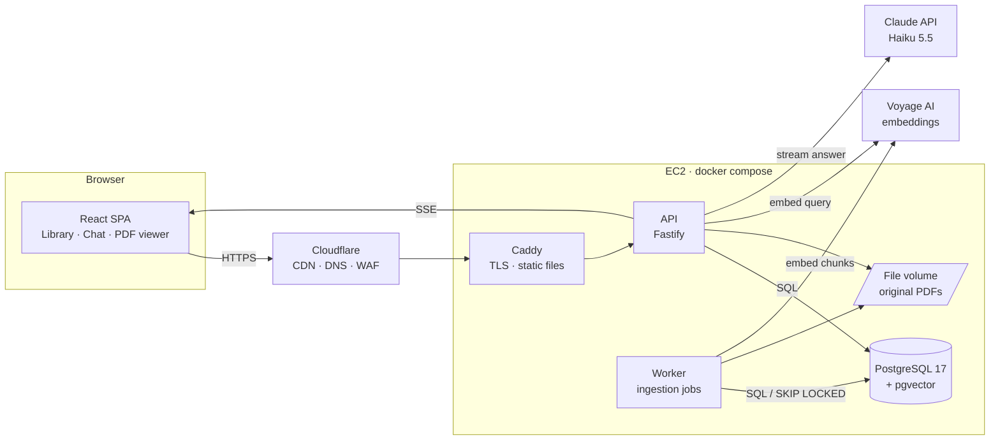
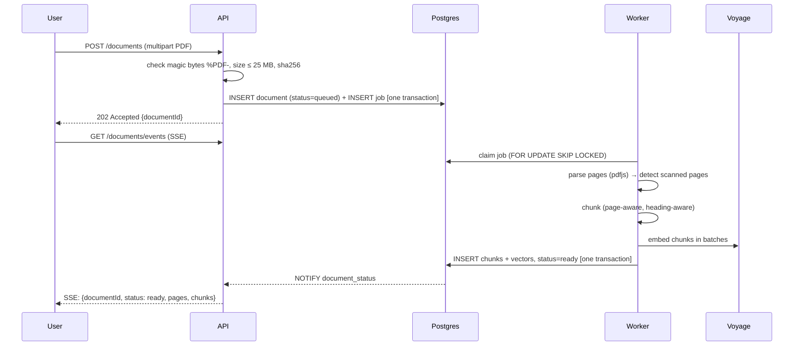
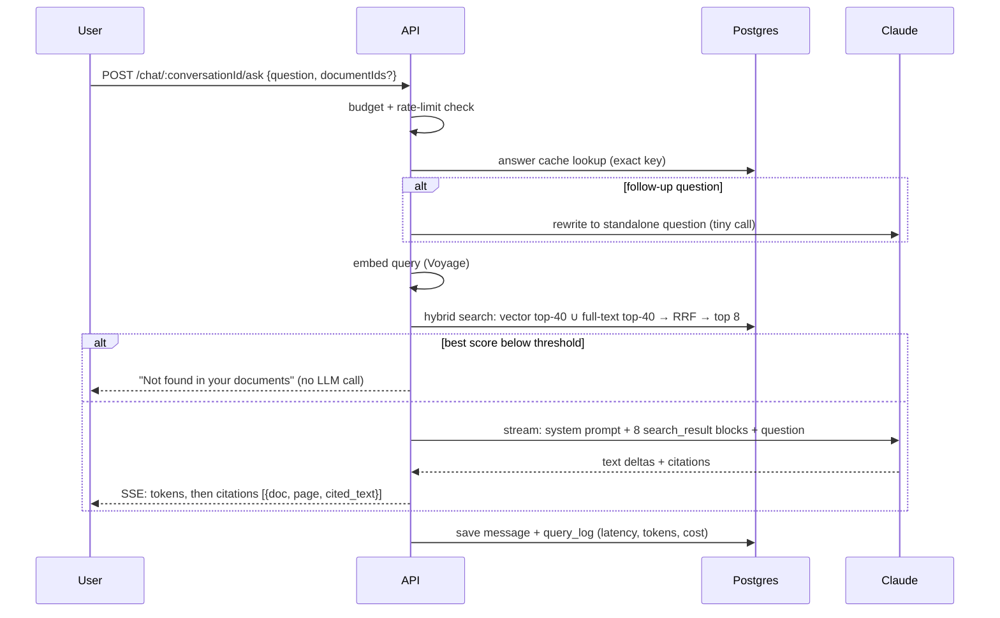

# DocuMind — Architecture & Design

> Upload PDFs. Ask questions across all of them. Get answers where every claim is cited to
> **document → page → exact passage**, and click a citation to open the PDF at that spot.

This document is the source of truth for *what* we build and *why*. Every decision below has a
"why not the alternative" so it can be defended in an interview.

---

## 1. Goals and non-goals

**Goals**
1. Answers are *grounded*: every sentence traces to a passage the user can verify in one click.
2. Retrieval quality is *measured*, not claimed: a 40-question eval set with a published score.
3. Cheap to run: under $0.001 per question, hard per-user budgets.
4. Production-shaped: background jobs, streaming, auth, rate limits, CI, Docker, HTTPS deploy.

**Non-goals (v1)**
- Scanned/image-only PDFs (no OCR). We *detect* them and tell the user, rather than fail silently.
- Team sharing / multi-tenant orgs. One user = one private library.
- Fine-tuning or self-hosted LLMs.

---

## 2. System overview



Two Node processes from **one codebase**: `api` (serves HTTP, never does heavy work) and
`worker` (parses, chunks, embeds). They talk only through Postgres. Postgres is the database,
the vector index, the full-text index, **and** the job queue.

---

## 3. The two pipelines

### 3.1 Ingestion (write path)



Key points:
- **Dedup:** `UNIQUE (user_id, sha256)` — re-uploading the same file costs zero embedding calls.
- **Atomicity:** chunks are written in one transaction, so a crash never leaves a half-indexed doc.
- **Retries:** jobs have `attempts` + exponential `run_after`. After 3 failures → `status=failed`
  with a human-readable error.
- **Live status:** worker issues `NOTIFY`; API `LISTEN`s and pushes to the browser over SSE.

### 3.2 Question answering (read path)



---

## 4. Core techniques

### 4.1 Chunking strategy
- Parse per page with `pdfjs-dist`, keeping `page_number` for every character run.
- Split recursively on structure: headings → paragraphs → sentences, packing into chunks of
  **~400 tokens with ~60 tokens overlap**. A chunk may span a page break, so we store
  `page_start` and `page_end`.
- **Contextual header:** before embedding, each chunk is prefixed with
  `"{document title} › {nearest heading}"`. A chunk that says "revenue grew 12%" is useless
  on its own; with the header the embedding knows *whose* revenue. It costs a few tokens per chunk.
- 400 is a *hypothesis*. The eval runs 200 / 400 / 800 and the README reports which won and by how much.

### 4.2 Hybrid retrieval with Reciprocal Rank Fusion
Vector search finds paraphrases ("staff turnover" ≈ "employee attrition") but misses exact
tokens such as drug names, IDs and numbers. Full-text search is the opposite. We run both and fuse
the two **rankings** (not their scores, which are on incomparable scales):

```sql
WITH vec AS (
  SELECT id, row_number() OVER (ORDER BY embedding <=> $1) AS rnk
  FROM chunks
  WHERE user_id = $2 AND document_id = ANY($3)
  ORDER BY embedding <=> $1
  LIMIT 40
),
kw AS (
  SELECT id, row_number() OVER (ORDER BY ts_rank_cd(tsv, q) DESC) AS rnk
  FROM chunks, websearch_to_tsquery('english', $4) q
  WHERE user_id = $2 AND document_id = ANY($3) AND tsv @@ q
  ORDER BY ts_rank_cd(tsv, q) DESC
  LIMIT 40
)
SELECT id, SUM(1.0 / (60 + rnk)) AS rrf_score
FROM (SELECT * FROM vec UNION ALL SELECT * FROM kw) both_lists
GROUP BY id
ORDER BY rrf_score DESC
LIMIT 8;
```

`k = 60` is the standard RRF constant. It damps the gap between rank 1 and rank 2 so that one
list can't dominate. Filtered HNSW scans can lose recall, so we enable pgvector's
`hnsw.iterative_scan` (0.8+).

### 4.3 Cited answers (native citations)
Each retrieved chunk is sent to Claude as a `search_result` content block with
`citations: {enabled: true}`, carrying `source = "doc:{id}#p{page_start}"` and the document title.
The API returns text blocks whose `citations` point at a specific search result plus the
exact `cited_text`. We map that back to `chunk → document → page`, and the viewer highlights
`cited_text` on that page.

### 4.4 Grounding and abstention
- System prompt: answer only from the provided sources; say so when they don't contain the answer.
- **Pre-LLM abstention:** if retrieval returns nothing relevant (threshold on cosine similarity of
  the best vector hit, tuned on the eval set), we answer "not found" *without* calling the LLM.
  It's cheaper, and the model can't invent an answer.
- The eval set includes ~6 unanswerable questions to measure this.

### 4.5 Follow-up questions
"What about 2023?" retrieves garbage. When a conversation has history, one tiny Haiku call
rewrites the question into a standalone one before retrieval. First questions skip this call.

---

## 5. Data model

```sql
CREATE EXTENSION IF NOT EXISTS vector;
CREATE EXTENSION IF NOT EXISTS citext;

users        (id uuid PK, email citext UNIQUE, password_hash text, created_at timestamptz)
sessions     (id text PK, user_id uuid FK, expires_at timestamptz)          -- revocable logins

documents    (id uuid PK, user_id uuid FK, title text, filename text, sha256 text,
              size_bytes int, page_count int, scanned_pages int,
              status text CHECK (status IN ('queued','processing','ready','failed')),
              error text, storage_key text, created_at timestamptz,
              UNIQUE (user_id, sha256))

chunks       (id bigserial PK, document_id uuid FK ON DELETE CASCADE,
              user_id uuid,                    -- denormalized: filter without a join
              ordinal int, page_start int, page_end int, heading text,
              content text, token_count int,
              embedding vector(1024),
              tsv tsvector GENERATED ALWAYS AS (to_tsvector('english', content)) STORED)
  INDEX hnsw (embedding vector_cosine_ops)
  INDEX gin  (tsv)
  INDEX btree (user_id, document_id)

jobs         (id bigserial PK, type text, payload jsonb, status text, attempts int,
              run_after timestamptz, locked_at timestamptz, last_error text)

conversations(id uuid PK, user_id uuid FK, title text, created_at timestamptz)
messages     (id uuid PK, conversation_id uuid FK, role text, content text,
              citations jsonb, created_at timestamptz)

query_logs   (id bigserial PK, user_id uuid, message_id uuid, rewritten_query text,
              retrieval_ms int, ttft_ms int, total_ms int,
              input_tokens int, output_tokens int, cost_usd numeric(10,6),
              cache_hit bool, chunk_ids bigint[], created_at timestamptz)

answer_cache (key text PK, response jsonb, created_at timestamptz)
```

`ON DELETE CASCADE` means deleting a document removes its chunks and vectors in the same
transaction. A separate vector DB can't promise that.

---

## 6. API surface

| Method | Path | Purpose |
|---|---|---|
| POST | `/auth/register`, `/auth/login`, `/auth/logout` | Session cookie (httpOnly, Secure, SameSite=Lax) |
| GET | `/me` | Current user + today's usage/budget |
| POST | `/documents` | Upload (multipart) → 202 |
| GET | `/documents` | Library list with status |
| GET | `/documents/events` | SSE stream of ingestion status |
| GET | `/documents/:id/file` | Stream the PDF (owner only) |
| DELETE | `/documents/:id` | Delete doc + chunks + file |
| POST | `/conversations` · GET `/conversations` · GET `/conversations/:id` | Chat history |
| POST | `/conversations/:id/ask` | SSE: `token`, `citations`, `trace`, `done` events |
| GET | `/metrics/summary` | p50/p95 latency, cost/day, cache hit rate |
| GET | `/health` | Liveness + DB check |

All request and response bodies are Zod schemas in `packages/shared`. Web and API import the same
types, so contract drift becomes a compile error.

---

## 7. Feature set

**Phase 1: the core loop (week 1)**
- Auth, upload with drag-and-drop, live ingestion progress
- Hybrid retrieval, streamed answers, clickable citation chips
- PDF viewer that opens at the cited page and highlights the passage

**Phase 2: what makes it stand out (week 2)**
- Conversations with follow-up rewriting
- Scope a question to selected documents
- **"Why this answer?" trace panel:** retrieved chunks, vector rank vs keyword rank vs fused rank,
  latency breakdown, token cost. Transparency is the feature reviewers remember.
- Eval harness + ablation table (chunk size × vector-only vs hybrid)
- Answer cache, per-user daily token budget, rate limits

**Phase 3: production (week 3)**
- Docker images, GitHub Actions CI (lint, typecheck, tests, eval smoke test)
- EC2 deploy behind Cloudflare, HTTPS, nightly `pg_dump` backup
- Metrics page: p50/p95 time-to-first-token, cost/query, accuracy badge

**Stretch:** reranking step, OCR for scanned pages, "compare across documents" answer mode,
Postgres row-level security as a second isolation layer.

---

## 8. Design decisions (the interview answers)

| # | Decision | Why | Why not the alternative |
|---|---|---|---|
| D1 | **pgvector**, not Pinecone/Qdrant | Vectors, full-text, metadata and jobs in one DB. Hybrid search is one SQL query. Per-user filtering is a `WHERE`. Deletes are transactional. No extra vendor or bill. | A managed vector DB pays off at tens of millions of vectors or multi-region needs. A personal library is thousands. |
| D2 | **Hybrid + RRF** | Covers both paraphrase and exact-term queries | Vector-only misses IDs and numbers. A learned reranker adds latency and cost. Measure first (stretch). |
| D3 | **~400-token chunks, 60 overlap, contextual header** | Small enough to be precise, big enough to hold a full claim | Chosen by eval ablation, not by folklore |
| D4 | **Native citations (`search_result` blocks)** | `cited_text` is returned by the API from the sources we sent, so citations can't point at text that doesn't exist | Prompting for `[1]` markers and parsing them is fragile and lets the model cite the wrong source |
| D5 | **Postgres queue with `FOR UPDATE SKIP LOCKED`** | No Redis. ~50 lines we fully understand. Jobs commit atomically with the document row. | BullMQ+Redis is great at high throughput. Ingestion here is a few jobs per minute. |
| D6 | **SSE**, not WebSockets | One-way server→client stream over plain HTTP. Auto-reconnect. Passes through Cloudflare. | WebSockets add a bidirectional protocol we don't need |
| D7 | **Fastify + TypeScript + Zod** | Built-in schema validation, fast, first-class TS. Shared types with the frontend. | Express has no validation or typing story out of the box |
| D8 | **Raw SQL (`pg`) + plain `.sql` migrations** | Vector ops, RRF and FTS are SQL-native. Every query is visible and explainable. | ORMs wrap `<=>` and `tsvector` awkwardly and hide the queries we want to show |
| D9 | **Server-side sessions** in an httpOnly cookie | Instantly revocable, no token in JS reach (XSS-safe) | Stateless JWTs can't be revoked before expiry without a denylist, which is a session table anyway |
| D10 | **Exact-key answer cache**, not semantic cache | Key = hash(normalized question + sorted doc ids + doc versions). Never serves a wrong answer. | A semantic cache returns the answer to a *similar* question, and "revenue 2022" vs "revenue 2023" are similar |
| D11 | **Claude Haiku 5.5** for answers and rewrites | $0.10 / $0.50 per M tokens. Model id is an env var, so upgrading is config, not code. | Bigger models only if the eval shows a real accuracy gap |
| D12 | **Voyage AI embeddings**, behind an `Embedder` interface | Anthropic's recommended embeddings partner. Interface means a fake embedder in unit tests. | Dimension is fixed per deployment. Switching models = migration + re-embed job. |
| D13 | **Caddy** as reverse proxy | Automatic TLS, one-line config, `flush_interval -1` for SSE | Nginx works too but needs more config for the same result |

---

## 9. Cost model

Per question: ~8 chunks × 400 tokens + prompt ≈ **4K input**, ~**500 output** tokens (thinking included).
With Haiku 5.5: 4,000 × $0.10/M + 500 × $0.50/M ≈ **$0.00065 per question** (~₹0.06).
That's ~1,500 questions per dollar. A full 40-question eval run costs about 3 cents.
Embedding a 100-page PDF ≈ 60K tokens, which costs fractions of a cent.

Guards: per-user daily token budget (default 200K), rate limit 20 asks/min, upload cap of
20 documents per user on the public demo, answer cache, pre-LLM abstention.

---

## 10. Security

- Uploads: magic-byte check, 25 MB / 300-page caps, files stored under random keys outside the web root.
- Isolation: every chunk/document query includes `user_id = $currentUser`. A test asserts that user B
  can never retrieve user A's chunks.
- Passwords: argon2id. Cookies: httpOnly, Secure, SameSite=Lax. `@fastify/helmet` headers. CORS locked to our origin.
- **Prompt injection:** document text enters only as `search_result` data. The model has no tools,
  so a malicious PDF can at worst distort its own answer. It can't trigger actions or leak other users' data.
- Secrets live in env only. The repo has `.env.example` only.

---

## 11. Evaluation

`eval/dataset.jsonl`: 40 questions over ~6 **public** PDFs (government reports, arXiv papers).
Each row: `question`, `gold_answer`, `gold_doc`, `gold_pages`, `answerable`.

| Metric | Meaning |
|---|---|
| Recall@8 | A gold page appears in the 8 retrieved chunks |
| MRR | How high the first gold chunk ranks |
| Answer correctness | LLM judge with a strict rubric vs `gold_answer` (0/1) |
| Citation precision | Share of citations that land on a gold page |
| Abstention accuracy | Unanswerable questions correctly declined |
| p50/p95 TTFT, cost/question | From `query_logs` |

`npm run eval -- --chunk-size 400 --mode hybrid` writes `eval/results/<date>.json`. The README
publishes the ablation table.

---

## 12. Repository layout

```
documind/
├─ apps/
│  ├─ api/                 Fastify API + worker (two entry points, one codebase)
│  │  ├─ migrations/       001_init.sql, 002_...
│  │  └─ src/
│  │     ├─ config.ts      env parsing (Zod) — app refuses to boot on bad config
│  │     ├─ db/            pool, migrate runner, query helpers
│  │     ├─ modules/       auth/ documents/ conversations/ metrics/  (routes + service per module)
│  │     ├─ ingestion/     parse.ts chunk.ts embed.ts pipeline.ts
│  │     ├─ retrieval/     hybrid.ts rewrite.ts
│  │     ├─ llm/           answer.ts (Claude streaming + citations)
│  │     ├─ jobs/          queue.ts worker.ts
│  │     ├─ server.ts      API entry
│  │     └─ worker.ts      worker entry
│  └─ web/                 React + Vite + TS
│     └─ src/ features/{auth,library,chat,viewer,trace}  lib/api.ts
├─ packages/shared/        Zod schemas + types used by both apps
├─ eval/                   dataset.jsonl, run.ts, results/
├─ docs/                   this file, screenshots
├─ docker-compose.yml      dev: postgres only · prod: + api, worker, caddy
└─ .github/workflows/ci.yml
```

---

## 13. UI design

Three-pane workspace, dark and light themes, Tailwind + shadcn/ui, TanStack Query for server state.

```
┌──────────────┬───────────────────────────────┬──────────────────────────┐
│ LIBRARY      │  CHAT                         │  SOURCE                  │
│ + Upload     │                               │  annual-report.pdf · p.14│
│ ▣ report.pdf │  Q: What drove 2023 growth?   │ ┌──────────────────────┐ │
│   ● ready    │                               │ │ …revenue grew 12%,   │ │
│ ▣ study.pdf  │  A: Mainly APAC expansion [1] │ │ ▇▇▇▇▇▇▇▇▇▇▇▇▇▇▇▇▇▇   │ │
│   ◌ 62% …    │  and a price change [2].      │ │ (highlighted passage)│ │
│              │                               │ └──────────────────────┘ │
│ Conversations│  [Why this answer? ▸]         │  ◂ prev cite  next ▸     │
│ · Q3 review  │  ┌─────────────────────────┐  │                          │
│              │  │ Ask across 2 documents… │  │                          │
└──────────────┴───────────────────────────────┴──────────────────────────┘
```

- Citation chips `[1]` show doc + page on hover. Clicking one opens the source pane at that page.
- Ingestion shows real stages (parsing → chunking → embedding), not a fake spinner.
- Empty, error and "not found in your documents" states are designed, not default text.
- Keyboard: `/` focuses the question box, `Esc` closes the source pane.

---

## 14. Build order (one small commit each)

1. Repo skeleton, docker-compose with pgvector, `.env.example`
2. API boot: config validation, `/health`, DB pool
3. Migration runner + `001_init.sql`
4. Auth (register/login/logout, sessions)
5. Upload endpoint + file storage + documents table
6. Job queue + worker loop
7. PDF parsing per page + scanned-page detection
8. Chunker + unit tests
9. Embedder interface + Voyage implementation
10. Ingestion pipeline end-to-end + SSE status
11. Hybrid retrieval SQL + tests
12. Claude answer streaming with citations
13. Web: auth + library + upload
14. Web: chat streaming + citation chips
15. Web: PDF viewer with highlight
16. Conversations + follow-up rewriting
17. Eval dataset + harness + first scores
18. Ablations, then tune chunk size and threshold
19. Trace panel + metrics page + budgets + cache
20. CI, Docker prod images, EC2 + Cloudflare deploy, README numbers
